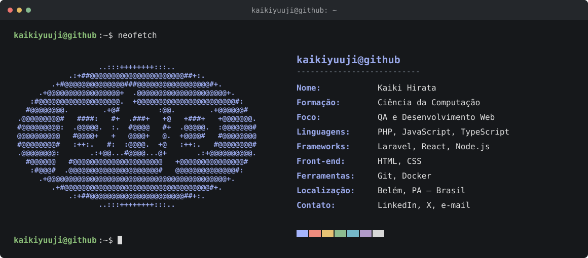

  
    
  <a href="https://www.linkedin.com/in/kaiki-yuuji/">LinkedIn</a> &nbsp; · &nbsp;
  <a href="https://x.com/euhirata">X / Twitter</a> &nbsp; · &nbsp;
  <a href="mailto:kaikiramoshirata@gmail.com">E-mail</a> &nbsp; · &nbsp;
  <a href="https://github.com/kaikiyuuji?tab=repositories">Projetos</a>

